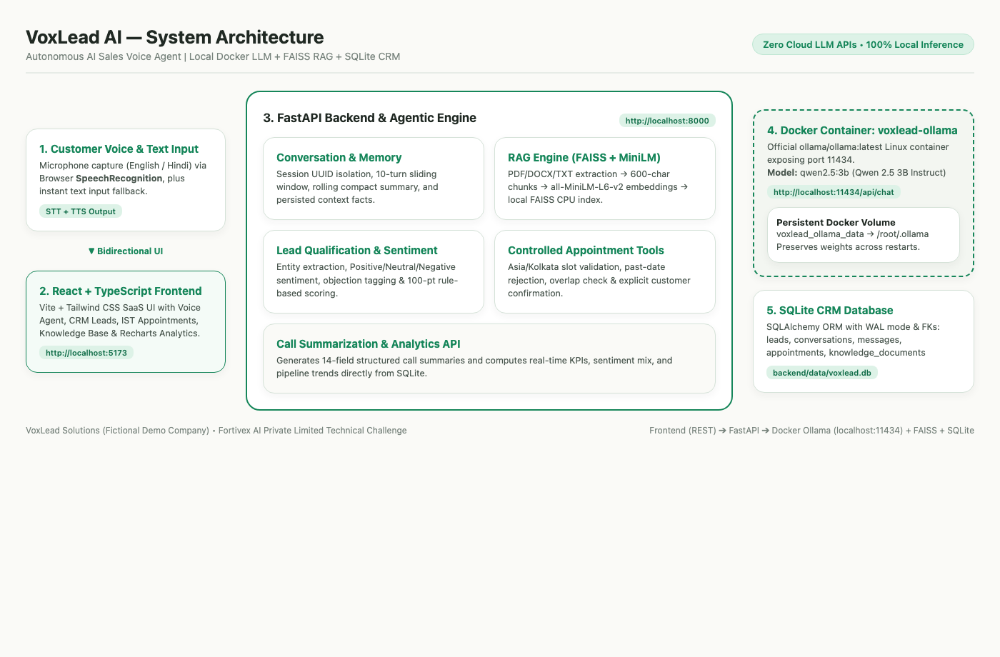
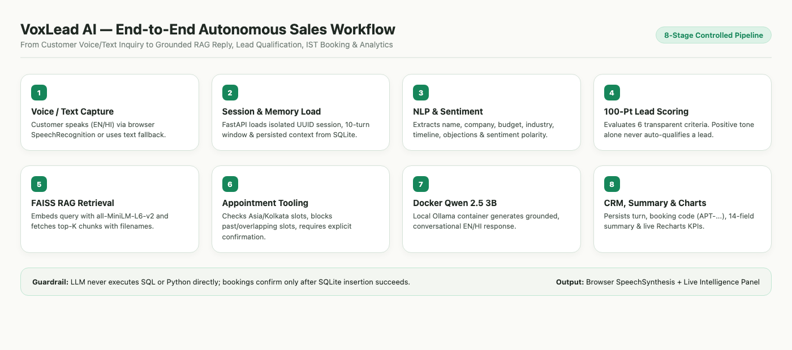

# VoxLead AI — Autonomous AI Sales Voice Agent

**VoxLead AI** is a full-stack autonomous AI sales voice and chat platform with a containerized local LLM (**Ollama + Qwen 2.5 3B**), local **FAISS RAG**, persistent contextual memory, transparent lead scoring, sentiment analysis, conflict-free **IST** appointment booking, structured AI call summaries, and a real-time **React + TypeScript** SaaS CRM dashboard.

> **Disclaimer:** The pre-loaded company documents and optional demo CRM seed records represent fictional sample business data for **VoxLead Solutions Pvt. Ltd.** created solely for technical demonstration.
>
> **Documentation:** [One-Page Project Report (Markdown)](docs/PROJECT_REPORT.md) | [One-Page Project Report (PDF)](docs/PROJECT_REPORT.pdf) | [System Design & Study Guide](systemdesign.md)

---

## Business Problem & Proposed Solution

Businesses lose qualified leads when inquiries arrive outside office hours or overwhelm small sales teams with repetitive questions about pricing, order tracking, and scheduling.

VoxLead AI automates the entire front-line sales workflow without relying on paid cloud LLM APIs:
1. Greets customers via **voice or text** in **English and Hindi**.
2. Grounded answers via **local RAG** (`all-MiniLM-L6-v2` + `FAISS CPU`) citing exact company source filenames.
3. Remembers facts across turns using **SQLite-persisted contextual memory**.
4. Extracts lead details, detects objections & sentiment, and computes a **transparent 100-point lead score**.
5. Checks live slot availability in **`Asia/Kolkata`**, prevents overlapping bookings, and persists confirmed calls in SQLite.
6. Generates **14-field structured call summaries** and updates **database-driven analytics charts**.

---

## Technology Stack

| Layer | Technology |
|---|---|
| Frontend | React 18, TypeScript, Vite, Tailwind CSS v4, Lucide React, Recharts |
| Voice I/O | Browser `SpeechRecognition` (Web Speech API) & `SpeechSynthesis` + Text Fallback |
| Backend | Python 3.11, FastAPI, Uvicorn, Pydantic v2, HTTPX |
| Local LLM | Dockerized Ollama (`ollama/ollama:latest`) running `qwen2.5:3b` |
| Embeddings & RAG | `sentence-transformers/all-MiniLM-L6-v2`, `faiss-cpu` |
| Database | SQLite + SQLAlchemy ORM |
| Testing | Pytest |

---

## Architecture Overview



```text
React Frontend (localhost:5173)
       │  REST JSON API
       ▼
FastAPI Backend (localhost:8000) ──► FAISS CPU + all-MiniLM-L6-v2 + SQLite CRM
       │  HTTP API (http://localhost:11434)
       ▼
Docker Container: voxlead-ollama (ollama/ollama:latest)
       │
       ▼
Qwen 2.5 3B Instruct (qwen2.5:3b) ──► Persistent Volume (voxlead_ollama_data)
```

- **Important Networking Note:** While FastAPI runs natively on macOS, `OLLAMA_BASE_URL` is `http://localhost:11434`. If you containerize the backend inside `docker-compose.yml` in a future deployment, change `OLLAMA_BASE_URL` to `http://ollama:11434`.
- **Voice Processing Transparency:** Browser `SpeechRecognition` relies on the browser vendor's speech service (which may require internet connectivity in Chrome/Edge). Full text input fallback is always available, while **all LLM inference, RAG embeddings, vector search, scoring, and CRM storage execute 100% locally**.

---

## Folder Structure

```text
VoxLead-AI/
├── frontend/                   # React + TypeScript + Vite + Tailwind SaaS UI
├── backend/
│   ├── app/
│   │   ├── api/                # chat, conversations, leads, appointments, knowledge, analytics
│   │   ├── services/           # ollama, conversation, memory, rag, embedding, lead, sentiment, scoring, booking, summary
│   │   ├── utils/              # prompts, validators, json_parser
│   │   ├── config.py           # Pydantic Settings reading backend/.env
│   │   ├── database.py         # SQLAlchemy SQLite engine & WAL setup
│   │   ├── models.py           # ORM tables (leads, conversations, messages, appointments, knowledge_documents)
│   │   ├── schemas.py          # Pydantic request/response models
│   │   └── main.py             # FastAPI app, lifespan bootstrap, /api/health, /api/settings
│   ├── tests/test_voxlead.py   # Pytest verification suite
│   ├── data/knowledge_base/    # Sample fictional company docs
│   ├── requirements.txt
│   ├── .env.example
│   └── .env
├── docs/
│   ├── architecture.png
│   ├── architecture.mmd
│   ├── workflow.png
│   ├── workflow.mmd
│   └── PROJECT_REPORT.md
├── scripts/
│   ├── start.sh
│   ├── stop.sh
│   ├── start_ollama.sh
│   ├── stop_ollama.sh
│   └── seed_database.py
├── docker-compose.yml
├── .gitignore
└── README.md
```

---

## Setup & Installation (macOS / Apple Silicon)

### 1. Start Docker Ollama Container
Ensure Docker Desktop is running, then launch the Ollama container:

```bash
docker compose up -d ollama
```

### 2. Pull Qwen 2.5 3B Model (One-Time Setup)
Models are stored in the persistent Docker volume `voxlead_ollama_data` and survive container restarts:

```bash
docker exec -it voxlead-ollama ollama pull qwen2.5:3b
docker exec -it voxlead-ollama ollama list
curl http://localhost:11434/api/tags
```

Optional interactive test:
```bash
docker exec -it voxlead-ollama ollama run qwen2.5:3b
```

> **Performance Note (MacBook Air M4 16GB):** Docker Desktop runs Linux containers inside a VM without native Apple Metal GPU passthrough. Using `qwen2.5:3b` with persistent HTTP connections and `keep_alive` keeps inference responsive. If even faster latency is needed during a demo, native macOS `ollama serve` on port `11434` is a drop-in fallback.

### 3. Environment Configuration
Review `backend/.env` (created from `backend/.env.example`):

```env
APP_NAME=VoxLead AI
APP_ENV=development
OLLAMA_BASE_URL=http://localhost:11434
OLLAMA_MODEL=qwen2.5:3b
DATABASE_URL=sqlite:///./data/voxlead.db
EMBEDDING_MODEL=sentence-transformers/all-MiniLM-L6-v2
DEFAULT_LANGUAGE=en
TIMEZONE=Asia/Kolkata
FRONTEND_URL=http://localhost:5173
```

### 4. Backend Setup
```bash
python3.11 -m venv backend/.venv
backend/.venv/bin/pip install -r backend/requirements.txt
```

Run backend manually:
```bash
cd backend
.venv/bin/uvicorn app.main:app --host 0.0.0.0 --port 8000 --reload
```

### 5. Frontend Setup
```bash
cd frontend
npm install
npm run dev
```

### 6. One-Command Start & Stop Scripts
```bash
./scripts/start.sh   # Checks Docker, starts Ollama, FastAPI (:8000), and Vite (:5173)
./scripts/stop.sh    # Stops backend, frontend, and Ollama without deleting persistent volumes or SQLite DB
```

Application URLs:
- **Frontend:** http://localhost:5173
- **Backend API:** http://localhost:8000
- **Swagger API Docs:** http://localhost:8000/docs
- **Ollama API:** http://localhost:11434

---

## End-to-End Demo Workflow



1. Open **AI Voice Agent** (`http://localhost:5173`), choose **English** or **Hindi**, and click **Start Conversation**.
2. Speak via microphone or type: *"Hi, I'm Aarav from CartPulse. We run an e-commerce store with 500 daily customer queries about order tracking and returns."*
3. Ask about pricing: *"What are your monthly pricing plans?"* → RAG retrieves `pricing.txt` and cites it.
4. State budget & timeline: *"Our budget is ₹40,000 per month and we want to launch this month."* → Lead score updates live in the right-hand Intelligence Panel.
5. Test contextual memory: *"What budget did I mention earlier?"* → Agent recalls `₹40,000`.
6. Book an appointment: *"Let's book a discovery call tomorrow at 15:00. Yes, please confirm."* → Persisted in SQLite with code `APT-...`.
7. Click **End & Summarize** → Structured 14-field summary is saved and visible under **Leads**, **Appointments**, **Overview**, and **Analytics**.

---

## Testing with Pytest

Run unit & integration tests:
```bash
backend/.venv/bin/pytest backend/tests/test_voxlead.py -v
```

Run including live Docker Ollama + Qwen 2.5 3B end-to-end test:
```bash
RUN_LIVE_OLLAMA_TESTS=1 backend/.venv/bin/pytest backend/tests/test_voxlead.py -v
```

---

## Security & Production Scalability (100,000 Registered Users)

### Security Implemented
- `.env`-driven configuration, zero cloud LLM keys, restricted CORS (`localhost:5173`).
- Filename sanitization, extension allowlist (`.pdf`, `.docx`, `.txt`), 10 MB upload cap, and path traversal checks.
- SQLAlchemy parameterized queries, Pydantic input validation, session isolation, and controlled Python tool routing (LLM never executes SQL or Python).

### Scaling Beyond Local MVP to 100,000 Users
The local SQLite + single-container Ollama setup is designed for local demonstration (not load-tested for 100k simultaneous calls). Note the distinction between **100,000 registered accounts** vs. **concurrent active calls** (typically 1–5% concurrency = 1,000–5,000 simultaneous sessions). Production scaling path:
- **Frontend:** Static Vite bundle served via CDN (Cloudflare / CloudFront).
- **Stateless API Tier:** Horizontally scaled FastAPI workers behind an L7 load balancer with connection pooling and rate limiting.
- **Data & Memory Tier:** PostgreSQL with indexed tenant partitions + Redis for sliding-window conversation memory and slot locking.
- **Vector Tier:** Managed Qdrant / pgvector / Milvus cluster + S3/GCS object storage for uploaded documents.
- **Async Pipelines:** Kafka or RabbitMQ workers for post-call LLM summarization and CRM webhook sync.
- **Inference & Telephony:** Dedicated GPU inference clusters (vLLM / TensorRT-LLM / multi-node Ollama) + WebRTC / SIP telephony (Twilio/LiveKit) + Prometheus & Grafana observability.

---

## GitHub Repository Preparation

```bash
git init
git add .
git status   # Verify .env, .venv, node_modules, *.db, uploads/*, and model weights are excluded
git commit -m "feat: implement VoxLead AI autonomous sales voice agent and CRM"
```
