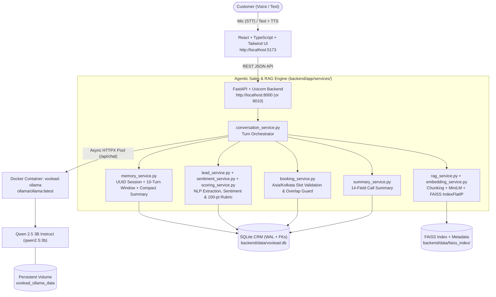

# VoxLead AI — Complete System Design, Architecture & Study Guide

> **Purpose:** End-to-end engineering, architecture, API, RAG, scalability, security, and commercial feasibility reference for **VoxLead AI – Autonomous AI Sales Voice Agent** (built for the technical discussion at Fortivex AI Private Limited).  
> **Demo Company:** VoxLead Solutions Pvt. Ltd. *(fictional sample business data)*

---

## 1. Business Problem & Proposed Solution

### The Problem
Growing businesses (e-commerce, healthcare clinics, real estate, SaaS, EdTech) lose revenue daily because:
1. **Slow response times:** Prospects leave when inbound inquiries wait hours for a reply outside 9:30 AM–7:00 PM business hours.
2. **Repetitive sales & support load:** Up to 60–70% of incoming queries ask recurring questions (pricing, plans, order tracking, onboarding timelines, FAQs).
3. **Unstructured CRM data:** Sales reps forget to log customer requirements, budgets, objections, and sentiment into the CRM consistently.
4. **Scheduling friction & double bookings:** Back-and-forth calls/emails to find valid discovery call slots waste time and cause overlaps.
5. **High cloud LLM costs & privacy concerns:** Sending every customer transcript to paid third-party LLM APIs introduces recurring per-token costs and data-residency risks.

### The VoxLead AI Solution
VoxLead AI provides a **full-stack autonomous AI sales voice & chat agent** running on a **local open-weight LLM (Qwen 2.5 3B inside Docker)** paired with **local FAISS RAG**, **SQLite CRM persistence**, **deterministic lead scoring**, and **conflict-free IST appointment booking**:
- Interacts in **English and Hindi** via voice (Browser `SpeechRecognition` / `SpeechSynthesis`) or text fallback.
- Grounds answers strictly in uploaded company documents with source filename citations.
- Extracts lead profile, detects sentiment and objections, calculates a transparent **100-point lead score**, books confirmed appointments in `Asia/Kolkata`, generates **14-field call summaries**, and surfaces real-time analytics.

---

## 2. Complete Technology Stack & Justification

| Layer | Technology | Exact Role in VoxLead AI | Why Chosen |
|---|---|---|---|
| **Frontend UI** | React 18 + TypeScript + Vite | Single-page SaaS CRM & Voice Agent interface | Strict type safety, fast HMR dev server, zero Streamlit UI limitations |
| **Styling** | Tailwind CSS v4 + CSS Variables | Warm-white (`#FAFAF7`) & emerald (`#16865A`) design system | Rapid responsive design, container-query tables, accessible focus states |
| **Icons & Charts** | Lucide React + Recharts | Crisp UI iconography & interactive database-driven charts | Lightweight React-native SVG charts (Area, Bar, Donut Pie) |
| **Voice I/O** | Web Speech API (`SpeechRecognition` & `SpeechSynthesis`) | Browser mic-to-text & AI text-to-speech playback (`en-IN` / `hi-IN`) | Zero backend audio server overhead for MVP; full text fallback always ready |
| **Backend API** | Python 3.11 + FastAPI + Uvicorn | Async REST API server (`app/main.py` & `app/api/*`) | Native async HTTPX calls to Ollama, automatic OpenAPI `/docs`, Pydantic validation |
| **Validation & Config** | Pydantic v2 + `pydantic-settings` | Request/response schemas & `.env` configuration | Strict boundary validation, prevents malformed inputs and hardcoded secrets |
| **Local LLM Runtime** | Docker (`ollama/ollama:latest`) | Isolated Linux container (`voxlead-ollama`) on port `11434` (or `11435` host override) | Reproducible deployment, persistent named volume `voxlead_ollama_data` |
| **LLM Model** | Qwen 2.5 3B Instruct (`qwen2.5:3b`) | Multi-turn bilingual sales dialogue & structured call summarization | Lightweight (~1.9 GB Q4_K_M), strong instruction following & English/Hindi capability on 16GB RAM |
| **Embeddings** | `sentence-transformers/all-MiniLM-L6-v2` | Local 384-dimensional dense sentence embeddings | Fast CPU inference, loaded once as a thread-safe singleton (`embedding_service.py`) |
| **Vector Store** | `faiss-cpu` (`IndexFlatIP`) | Local cosine similarity search over normalized embeddings | Sub-millisecond local vector retrieval persisted on disk (`index.faiss` + `chunks.json`) |
| **Document Parsing** | `pypdf` + `python-docx` | Text extraction from `.pdf`, `.docx`, `.txt` uploads | Clean document ingestion without heavy external OCR dependencies |
| **Database & ORM** | SQLite (WAL mode + FKs) + SQLAlchemy 2.0 | Persists leads, conversations, messages, appointments, KB metadata, settings | Zero-ops local ACID persistence surviving browser refreshes and restarts |
| **Testing** | Pytest + FastAPI `TestClient` | Automated unit, integration, and live Ollama E2E tests | Verifies RAG, memory, scoring, overlap prevention, and error handling |

---

## 3. System Design Architecture

### High-Level Component Diagram

### Architectural Principles Used
1. **Separation of Concerns (Router → Service → Model):**
   - `app/api/*` handles HTTP validation, status codes, and dependency injection.
   - `app/services/*` owns all business logic (RAG, LLM client, scoring, booking, memory).
   - `app/models.py` & `app/database.py` isolate relational persistence.
2. **Controlled Tool Routing (AI Safety):**
   - The LLM (`qwen2.5:3b`) **never** generates raw SQL or executes Python code.
   - Python deterministically executes entity extraction, scoring, RAG lookup, and slot booking, and injects **authoritative tool state** (e.g., `BOOKING CONFIRMED` or `AVAILABLE SLOTS`) into the system prompt.
3. **Single-Call Latency Optimization:**
   - Because Docker Desktop on macOS runs inside a Linux VM without Apple Metal passthrough, each turn makes **one** LLM call (`ollama_service.chat`) with `keep_alive: "15m"` and `num_ctx: 4096` while extraction, sentiment, scoring, and FAISS retrieval execute in ~15–25 ms locally in Python.

---

## 4. End-to-End Business Workflow & Data Flow

Below is the exact step-by-step data flow when a customer speaks or types a message in **AI Voice Agent** (`frontend/src/pages/VoiceAgent.tsx`):

1. **Voice/Text Capture (`useSpeech.ts` / `VoiceAgent.tsx`):**
   - Customer clicks the mic and speaks (`SpeechRecognition`, `en-IN` or `hi-IN`).
   - `useSpeech` captures interim + final transcripts, auto-submits after `1.6s` of silence (or on manual mic stop / **Send Now** button, solving Safari's interim-only `onend` behavior).
   - Text fallback input is always active and guarded against IME composition (`!e.nativeEvent.isComposing`).
2. **REST Request (`POST /api/chat`):**
   - Frontend sends `{ session_id, message, language, channel, customer_name, customer_email, customer_phone, company }`.
3. **Session & Contextual Memory Load (`memory_service.py`):**
   - Fetches or creates an isolated `Conversation` row (UUID `session_id`) and loads `extracted_context_json` (persisted facts like `budget`, `company`, `pending_slot`).
4. **Entity Extraction, Sentiment & Scoring (`lead_service.py`, `sentiment_service.py`, `scoring_service.py`):**
   - Extracts name, email, phone, company, industry, budget (`₹40,000` → `40000.0`), business size/volume, timeline, requirement, pain points, services discussed, and buying intent.
   - Merges **only non-null** updates so previously shared facts (e.g., budget stated 10 turns ago) are never overwritten.
   - Classifies sentiment (`Positive`, `Neutral`, `Negative`) and extracts objections (e.g., `"Pricing / Budget concern"`).
   - Calculates the deterministic **100-point lead score** across 6 criteria:
     - Requirement clarity: `0–20`
     - Budget readiness: `0–20`
     - Buying intent: `0–25`
     - Business need: `0–15`
     - Purchase timeline: `0–10`
     - Engagement: `0–10`
   - **Rule:** Positive sentiment alone never marks a lead as `Qualified`.
5. **CRM Lead Sync (`lead_service.sync_lead_from_context`):**
   - Upserts the `Lead` row in SQLite and links `conversation.lead_id`.
6. **Controlled Appointment Tooling (`conversation_service.py` → `booking_service.py`):**
   - Detects appointment intent, date/time requests (`tomorrow`, `YYYY-MM-DD`, `15:00`, `3 pm`), and explicit confirmation (`yes`, `confirm`, `हाँ`, `कन्फर्म`).
   - Validates against `Asia/Kolkata` current time (rejects past slots) and checks overlapping `[start, start + duration)` intervals for `Sales Specialist`.
   - Inserts `Appointment` (`APT-YYYYMMDD-001`) **only** when slot is free, customer name is present, and explicit confirmation is given.
7. **RAG Retrieval (`rag_service.py`):**
   - Encodes user message via `all-MiniLM-L6-v2` and runs `IndexFlatIP.search()` (`top_k = 4`, `min_score = 0.18`).
   - Returns top chunks with exact source filenames (`pricing.txt`, `services.txt`, `faq.txt`, etc.).
8. **Grounded Prompt & Local LLM Inference (`prompts.py` → `ollama_service.py`):**
   - System prompt combines: language rule (`en`/`hi`), `KNOWN CUSTOMER CONTEXT`, rolling `compact_summary` (when >10 turns), `LIVE APPOINTMENT SYSTEM STATUS`, and `RETRIEVED COMPANY KNOWLEDGE`.
   - Calls Docker Ollama `POST /api/chat` with the last 10 messages (sliding window).
9. **Persistence, Summarization & Response:**
   - Saves assistant message + RAG sources to `messages`.
   - Updates `structured_summary_json` on both `Conversation` and `Lead` (and full LLM synthesis runs when clicking **End & Summarize** via `POST /api/conversations/{id}/summary`).
   - Returns `ChatResponse` (`reply`, `sources`, `intelligence`, `latency_ms`, `ollama_used`) to React.
   - React updates the chat transcript, plays `SpeechSynthesis` audio (if TTS enabled), and updates the right-hand **Conversation Intelligence Panel** live.

---

## 5. Complete API Flows & Contracts

Base URL (local dev): `http://localhost:8000` (or `http://localhost:8010` when running alongside another port-8000 service). Interactive Swagger docs: `/docs`.

### Health & Settings
- `GET /api/health` → Checks SQLite (`SELECT 1`), Ollama `GET /api/tags` + `qwen2.5:3b` presence, `embedding_service.status`, and indexed `knowledge_chunks`.
- `GET /api/settings` / `PUT /api/settings` → Reads/updates `WorkspaceSettings` (`default_language`, `voice_rate`, `tts_enabled`, `business_name`, `business_hours`, `appointment_duration`, `qualification_threshold`).
- `POST /api/demo/seed` → Explicitly seeds 5 fictional sample leads, conversations, and appointments when CRM is empty.

### Chat & Conversations
- `POST /api/chat` → Accepts `ChatRequest`; executes full agentic pipeline; returns `ChatResponse`.
- `GET /api/conversations` → Lists sessions ordered by `updated_at DESC`.
- `GET /api/conversations/{id}` → Returns session metadata + `structured_summary`.
- `GET /api/conversations/{id}/messages` → Ordered message transcript with `sources`.
- `POST /api/conversations/{id}/summary?mark_completed=true` → Runs `summary_service.generate_call_summary(..., use_llm=True)` via Ollama (with deterministic fallback) and persists the 14-field summary.

### CRM Leads (`backend/app/api/leads.py`)
- `GET /api/leads?search=&status=&sentiment=&sort_by=created_at&sort_order=desc` → Filterable, searchable, sortable lead directory.
- `POST /api/leads` → Manual lead creation (`201 Created`).
- `GET /api/leads/{id}` / `PUT /api/leads/{id}` / `DELETE /api/leads/{id}` → View, edit, or delete lead (cascades cleanly).

### Appointments (`backend/app/api/appointments.py`)
- `GET /api/appointments/slots/available?date=YYYY-MM-DD&duration_minutes=30` → Returns open `Asia/Kolkata` slots (10:00–18:00, excluding Sundays, past times, and booked overlaps).
- `GET /api/appointments?search=&date=&status=` → Lists scheduled calls.
- `POST /api/appointments` → Enforces `confirmed_by_customer=True`, non-past IST slot, idempotent duplicate check per `conversation_id`, and interval overlap check (`400 Bad Request` on conflict).
- `PUT /api/appointments/{id}` → Updates/reschedules with overlap & past-date guards.
- `DELETE /api/appointments/{id}?hard_delete=false` → Soft-cancels (`status = "Cancelled"`) by default to preserve audit history.

### Knowledge Base (`backend/app/api/knowledge.py`)
- `GET /api/knowledge` → Lists all indexed sample and uploaded documents with chunk & character counts.
- `POST /api/knowledge/upload` → Accepts multipart `.pdf`, `.docx`, or `.txt` (max 10 MB), sanitizes filename, extracts text, saves to `backend/data/uploads/`, and rebuilds FAISS.
- `POST /api/knowledge/text` → Creates a `.txt` entry from manual title + content and reindexes.
- `POST /api/knowledge/reindex` → Rebuilds FAISS index across all active documents.
- `DELETE /api/knowledge/{id}` → Deletes DB record (and uploaded file if non-sample) and rebuilds FAISS so removed content immediately disappears from future retrieval.

### Analytics (`backend/app/api/analytics.py`)
- `GET /api/analytics/overview` → Total leads, qualified leads, active appointments, conversion rate %, average lead score, conversation count, popular services, common objections, recent activity.
- `GET /api/analytics/leads` → Daily timeline (`total` vs `qualified`), breakdown by status, breakdown by potential tier.
- `GET /api/analytics/sentiment` → `Positive`, `Neutral`, `Negative` counts.
- `GET /api/analytics/appointments` → Daily confirmed/completed/cancelled trends and status counts.

---

## 6. RAG Production Pipeline Details

### Current Local Implementation (`rag_service.py`)
1. **Ingestion & Extraction:** `.txt` (UTF-8), `.pdf` (`pypdf.PdfReader`), `.docx` (`python-docx`).
2. **Cleaning (`validators.clean_text`):** Strips null bytes, normalizes `\r\n`, collapses excessive spaces/blank lines.
3. **Boundary-Aware Chunking:** `chunk_size = 600` chars, `overlap = 90` chars; searches backward for `\n\n`, `\n`, or `. ` inside the trailing window so sentences aren't needlessly cut mid-word.
4. **Embedding & Persistence:** `all-MiniLM-L6-v2` produces L2-normalized 384-dim `float32` vectors. Stored in `faiss.IndexFlatIP` (inner product on normalized vectors = exact cosine similarity) and saved to `backend/data/faiss_index/index.faiss` + `chunks.json`.
5. **Retrieval & Grounding:** Top-4 chunks with score `>= 0.18` are formatted with `[Source: filename | Relevance: score]` into the system prompt.

### Upgrading RAG for Production Scale
- **Hybrid Search (Dense + Sparse BM25):** Combines semantic embeddings with exact keyword matching (critical for SKU codes, exact INR prices, or policy IDs).
- **Cross-Encoder Reranking:** Rerank top-20 retrieved chunks down to top-4 using `BAAI/bge-reranker-base` for higher precision.
- **Metadata Filtering & Tenant Isolation:** Store `tenant_id`, `department`, `effective_date` in Qdrant or `pgvector` so each client searches only its own namespace.
- **Incremental Upserts & Deletes:** Replace full-index rebuilds with vector-ID deletes and incremental upserts per document ID.

---

## 7. Database Design (SQLite + SQLAlchemy)

All tables live in `backend/data/voxlead.db` with `PRAGMA foreign_keys=ON` and `PRAGMA journal_mode=WAL`:

| Table | Primary Key | Foreign Keys & Indexes | Stored Data |
|---|---|---|---|
| `leads` | `id` (Int) | Indexed `email`, `lead_score`, `status`, `created_at` | Contact info, industry, requirement, budget (`budget_numeric`), `score_breakdown_json`, `summary_json` |
| `conversations` | `id` (UUID Str) | `lead_id -> leads.id (SET NULL)` | `language`, `channel`, `status`, `compact_summary`, `structured_summary_json`, `extracted_context_json`, `message_count` |
| `messages` | `id` (Int) | `conversation_id -> conversations.id (CASCADE)` | `role`, `content`, `language`, `sentiment`, `sources_json`, `metadata_json`, `created_at` |
| `appointments` | `id` (Int) | `lead_id -> leads.id`, `conversation_id -> conversations.id`, composite index `ix_appointments_slot_lookup` | `appointment_code`, `scheduled_date`, `scheduled_time`, `duration_minutes`, `timezone` (`Asia/Kolkata`), `status`, `confirmed_by_customer` |
| `knowledge_documents` | `id` (Int) | Unique `filename` | `original_filename`, `file_type`, `file_path`, `chunk_count`, `character_count`, `is_sample`, `status` |
| `app_settings` | `key` (Str) | PK `key` | JSON-serialized workspace settings (`workspace_settings`) |

---

## 8. Commercial Feasibility & Operational Cost Analysis

### Local Open-Weight LLM vs. Paid Cloud APIs
- **Zero Per-Token Cost:** With Qwen 2.5 3B self-hosted via Ollama, marginal token cost is \$0. Adding voice/chat volume does not multiply monthly OpenAI/Gemini bills.
- **Predictable Fixed Infrastructure Cost:**
  - *Single SMB Deployment:* A modest cloud VM or on-prem Mac Mini / entry GPU node (e.g., 16 GB RAM or T4/L4 GPU) handles thousands of daily chat turns for a flat monthly server cost.
  - *Estimated Cloud SaaS Infrastructure (Production Multi-Tenant):*
    - 1x GPU inference node (e.g., NVIDIA L4 24GB running vLLM with continuous batching): ~\$350–\$550/month, capable of serving dozens of concurrent 3B/7B requests.
    - Managed PostgreSQL + Redis + Load Balancer + Object Storage: ~\$120–\$250/month.
    - Total ~\$500–\$800/month fixed infra serving 10,000+ conversations/day = **< \$0.003 per conversation** (versus high per-minute voice AI SaaS platforms charging \$0.08–\$0.20/minute).
- **Unit Economics for VoxLead Solutions (Sample Pricing):**
  - Growth Plan at ₹44,999/month (~12,000 conversations) yields >80% gross margin when amortized across shared GPU inference infrastructure.

---

## 9. Scalability Strategy: Supporting Up to 1,00,000 (100,000) Users

> **Crucial System Design Distinction:** **1,00,000 registered users** ≠ **1,00,000 simultaneous active voice calls**. Under typical B2B/B2C traffic (1–5% daily concurrency and 0.5–2% peak-second concurrency), 100k users translates to **~1,000–2,000 concurrent active sessions** and **~150–400 requests/sec at peak**.

### Local MVP vs. 100k Production Architecture

| Component | Local MVP (Current Repo) | 100,000-User Production Architecture |
|---|---|---|
| **Frontend** | Local Vite dev/static bundle | Static React build on **CDN** (Cloudflare / CloudFront) with edge caching |
| **API Layer** | Single Uvicorn process (`localhost:8000`) | **Stateless FastAPI pods** (Kubernetes / ECS) behind L7 Load Balancer + rate limiting |
| **Session Memory** | SQLite `extracted_context_json` + `messages` | **Redis Cluster** (hot sliding-window cache, TTL, distributed slot locks) + PostgreSQL archive |
| **Relational CRM** | SQLite (`voxlead.db`) | **PostgreSQL** (Primary + Read Replicas for Analytics) + **PgBouncer** connection pooling + composite indexes on `(tenant_id, status, created_at)` |
| **Vector Database** | Local `faiss-cpu` file (`index.faiss`) | **Qdrant / Milvus / pgvector** distributed cluster with tenant-scoped collections & HNSW indexes |
| **File Storage** | Local `backend/data/uploads/` | **S3 / GCS** encrypted object storage with async ingestion workers |
| **Async Jobs** | Synchronous call summary generation | **Kafka / RabbitMQ + Celery/Temporal workers** for post-call summaries, PDF OCR/chunking, CRM webhooks |
| **LLM Inference** | Single Docker Ollama (`qwen2.5:3b`) | **Dedicated GPU cluster running vLLM / TensorRT-LLM** with continuous batching, autoscaling on queue depth & KV-cache utilization |
| **Voice Transport** | Browser Web Speech API | **WebRTC (LiveKit) + SIP Telephony (Twilio/Exotel)** + streaming Whisper/Deepgram STT + low-latency streaming TTS |
| **Observability** | Logs + `/api/health` | **Prometheus + Grafana** (TTFT latency, tokens/sec, queue depth, booking error rate) + OpenTelemetry tracing |

### Key Bottlenecks & Mitigations at 100k Scale
1. **Appointment Double-Booking Race Condition:** Use **Redis distributed locks** (`SET slot:{resource}:{date}:{time} NX PX 5000`) + PostgreSQL `EXCLUDE USING gist` / unique constraint on active bookings so two concurrent calls can never book the same slot.
2. **LLM GPU Saturation:** Separate **real-time chat inference** (high-priority vLLM pool) from **batch call summarization** (background queue workers with backpressure).
3. **Analytics Queries Slowing OLTP Writes:** Route `GET /api/analytics/*` to a PostgreSQL **read replica** or pre-aggregated materialized views refreshed periodically.

---

## 10. Data Security, Privacy & Production Hardening

### Already Implemented in Current MVP
- **Zero Hardcoded Secrets / Zero Cloud LLM Keys:** Config loaded strictly via `backend/.env` (`Pydantic Settings`); `.env` excluded in `.gitignore`.
- **Upload Security:** `validators.sanitize_filename` strips path traversal (`os.path.basename` + regex allowlist), enforces `.txt`/`.pdf`/`.docx`, caps uploads at `10 MB`, and validates paths via `ensure_safe_path`.
- **Database Safety:** SQLAlchemy ORM parameterized queries (SQL-injection safe) and foreign-key constraints.
- **CORS & Session Isolation:** Restricted CORS (`FRONTEND_URL` / `localhost:5173`) and isolated UUID conversation sessions.
- **No Arbitrary Execution:** LLM output is plain text or parsed via `json.loads` (`json_parser.py`)—never `eval()` or raw SQL.

### Required Additions for Enterprise Production
1. **Authentication & RBAC:** OAuth2/OIDC + JWT access tokens with Admin, Sales Manager, and Agent roles.
2. **Multi-Tenant Isolation:** Mandatory `tenant_id` row-level security (PostgreSQL RLS) and tenant-isolated vector namespaces.
3. **Encryption:** TLS 1.3 in transit; KMS-managed AES-256 encryption at rest for RDS/S3/volumes.
4. **Audit Logging & Compliance:** Immutable audit trail for lead edits, deletions, and data exports; configurable PII redaction & retention windows (India DPDP Act / GDPR).
5. **Automated Backups:** Daily encrypted PostgreSQL snapshots + point-in-time recovery (PITR) + S3 versioning.

---

## 11. Future Improvements & New Business Ideas

### Technical Roadmap & Improvements
1. **Fully Offline Local Voice (Whisper + Piper/Kokoro TTS):** Replace browser-dependent `SpeechRecognition` with local `faster-whisper` over WebSocket audio streaming for 100% air-gapped voice calls.
2. **Streaming Token-by-Token Voice Pipeline:** Stream Ollama tokens sentence-by-sentence directly into TTS to cut perceived voice latency below 800 ms.
3. **LLM-Assisted Hybrid Entity Extractor + Reranker:** Add a lightweight cross-encoder reranker and Hindi/Hinglish code-mixed NER fine-tuning.
4. **Two-Way Calendar & CRM Webhooks:** Sync confirmed bookings to Google Calendar / Cal.com and push qualified leads to Zoho CRM, HubSpot, or Salesforce.
5. **WhatsApp Business API & Telephony Integration:** Connect the same `conversation_service` orchestrator to WhatsApp webhooks and SIP/PSTN voice trunks.

### High-Potential Commercial Business Ideas Built on This Architecture
1. **VoxLead ClinicOS (Healthcare & Diagnostics):** Automated Hindi/English patient appointment booking, test-prep instructions via RAG, and no-show reminder calls.
2. **VoxLead Realty Desk (Real Estate):** 24/7 inbound property buyer qualification (budget, BHK, locality), automated site-visit scheduling, and CRM scoring for builders.
3. **VoxLead D2C Concierge (E-commerce):** Order tracking, return/exchange eligibility checks grounded in store policies, and cart-recovery outbound voice calls.
4. **Private On-Premise AI Appliance (BFSI / Legal):** Zero-cloud boxed deployment (Docker + local Qwen + local Whisper + FAISS) sold on annual enterprise licensing for privacy-strict regulated industries.

---

## 12. Quick Revision Cheat Sheet (For Technical Interviews)

- **Why Qwen 2.5 3B inside Docker?** Keeps inference free, private, and reproducible across machines; 3B fits comfortably in 16 GB MacBook RAM alongside SentenceTransformers and Vite.
- **Why `localhost:11434` vs `ollama:11434`?** FastAPI runs natively on macOS and hits Docker's published host port (`11434`, or `11435` when another local Ollama uses `11434`). Inside a full Docker Compose backend container, it switches to internal DNS `http://ollama:11434`.
- **How do you prevent LLM hallucinations on pricing or fake bookings?** Pricing answers come strictly from FAISS RAG chunks with filename citations; appointments are booked **only** via Python `booking_service.create_appointment()` and the prompt forbids claiming confirmation unless the DB returns `BOOKING CONFIRMED` with an `APT-...` code.
- **How does memory survive long conversations without blowing up the context window?** `memory_service.py` sends a 10-message sliding window + a rolling `compact_summary` + structured `extracted_context_json` facts persisted in SQLite.
- **How do you ensure a positive-sounding window shopper isn't marked Qualified?** `scoring_service.py` separates sentiment from a deterministic 100-point rubric (`Requirement 20 + Budget 20 + Intent 25 + Need 15 + Timeline 10 + Engagement 10`) and requires score threshold + real requirement + buying intent.
